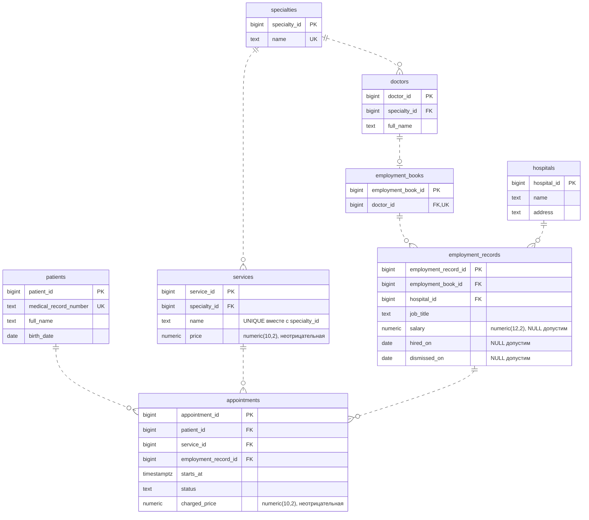
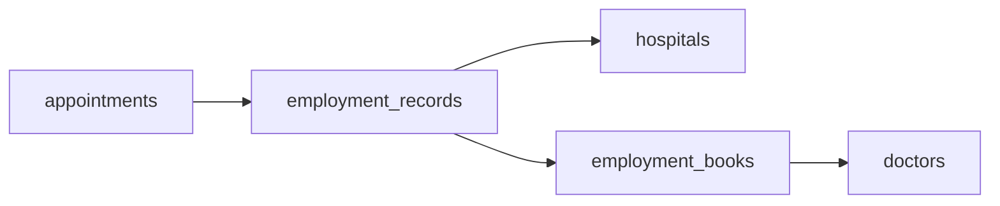

# Утверждённая схема ЛР №1

ЛР №1 принята без оценки; о сдаче сообщено 1 ноября 2026 года. Связи восстановлены по фотографии `IMG_6657.jpeg` и принятому решению. Атрибуты приведены по `schema.sql` и приведённой в порядок `migration.sql`.

## Как определяется врач и больница приёма

Приём содержит одну обязательную ссылку `employment_record_id`. Больницу получаем из этой записи о работе, врача — через её книжку. В `appointments` нет прямых `doctor_id` и `hospital_id`. Обсуждавшийся контур из этих пяти таблиц устранён. Связи специальностей и услуг исходной модели сохранены.

`||` означает ровно одну строку, `o|` — ноль или одну, `o{` — ноль или много. У врача не более одной книжки благодаря UNIQUE по `doctor_id`. Миграция создаёт книжки существующим врачам; для нового врача книжку добавляют отдельно. Изображённая необязательность книжки отражает реальные ограничения SQL.

Все поля обязательны, кроме `salary`, `hired_on` и `dismissed_on`. Зарплата, если известна, неотрицательна. Если заполнена дата увольнения, должна быть известна дата трудоустройства, и увольнение не может быть раньше неё. `NULL` в дате увольнения означает, что дата не указана; само по себе это не доказывает, что работа продолжается.

Должность и зарплата относятся к записи о работе. Повторная работа в той же больнице допускается отдельной строкой. Автоматической проверки периода работы относительно даты приёма нет.

## Границы проверки ограничений

FK гарантируют существование пациента, услуги, записи о работе, книжки, врача и больницы. Все удаления связанных родительских строк ограничены `ON DELETE RESTRICT`.

После удаления `appointments.doctor_id` прежний индекс занятости врача и две зависимые проверки исходной схемы не сохраняются. В этом варианте нет автоматического запрета одновременных приёмов врача, проверки соответствия специальности врача услуге и защиты специальности врача от изменения при наличии приёмов. Новых триггеров и индексов миграция не добавляет. Прежняя защита специальности используемой услуги сохраняется.

Эта диаграмма описывает итог ЛР №1. ЛР №2 пока использует исходную схему из пяти таблиц и не изменялась.
